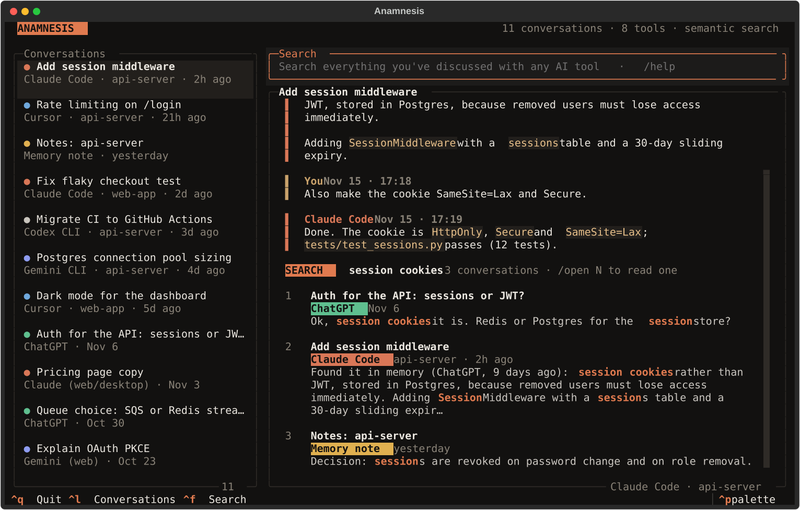

<h1 align="center"></h1>

<p align="center"><b>Never lose an AI conversation again.</b><br>Every conversation with every AI tool, kept on your computer and searchable by all of them.</p>

<p align="center">
  <a href="https://github.com/devHaitham481/anamnesis/actions/workflows/ci.yml"></a>
  <a href="https://github.com/devHaitham481/anamnesis/blob/main/LICENSE"></a>
  
  
  <a href="https://devhaitham481.github.io/anamnesis/"></a>
</p>

<p align="center">
  
  
  
  
  
  
</p>

<p align="center"></p>

<p align="center"><sub><code>anam status</code>, then Claude Code finding an old ChatGPT decision on its own (sample data).</sub></p>

Your AI tools don't keep your history for long. Claude Code deletes sessions after 30 days, and web chats stay locked inside their apps. Anamnesis keeps a permanent, word-for-word archive of your conversations from **Claude Code, Codex, Gemini CLI, Cursor, ChatGPT, claude.ai and Gemini** on your computer, and gives it back to every AI tool over [MCP](https://modelcontextprotocol.io). Ask Claude Code "what did we decide about auth?" and it finds the answer, even if you worked it out in ChatGPT months ago.

- **Keeps:** every conversation, permanently, even after the tool itself has deleted it.
- **Collects:** reads the history your AI tools already keep, in the background.
- **Recalls:** keyword and semantic search, run locally, for every connected agent. A search takes about a tenth of a second.
- **Remembers:** agents save decisions with `remember`, visible to all your tools.
- **Stays yours:** everything in local SQLite, with a small local embedding model. No account, no API keys, no telemetry.

It is only the memory: it never calls a model, and you keep using the tools you already use.


## Why "Anamnesis"?

*Anamnesis* (Greek ἀνάμνησις) means "recollection". In Plato it's the idea that learning is remembering what you already knew; in medicine it's a patient's history, taken so nobody starts from scratch. Both fit: your AI tools recall what you already worked out, with your whole history in front of them.

## Install

On macOS or Linux:

```bash
curl -LsSf https://devhaitham481.github.io/anamnesis/install.sh | sh
```

The [script](https://devhaitham481.github.io/anamnesis/install.sh) installs [uv](https://docs.astral.sh/uv/) if needed, then Anamnesis in its own environment, with its own Python (nothing to preinstall; your system Python is never touched). Then it runs `anam setup`, which:

1. finds the AI tools on your computer,
2. archives their history (the first run downloads a 70 MB search model),
3. offers to stop Claude Code deleting old sessions,
4. asks, then connects them (each config is backed up first),
5. shows what's archived and how to add your web chats.

**Then restart your AI tools.** That's it.

<details>
<summary>Install without the script</summary>

```bash
uv tool install git+https://github.com/devHaitham481/anamnesis   # or: pipx install git+https://…
anam setup
```

Needs macOS or Linux (on Windows, use WSL) and Python 3.11+ (uv fetches it if needed).
</details>

<details>
<summary>Update, uninstall</summary>

**Update:** run the install command again. Setup re-runs safely and repairs tool connections left by an older version.

**Uninstall:**

```bash
anam disconnect all          # remove Anamnesis from your AI tools' configs
uv tool uninstall anamnesis-cli
rm -rf ~/.anamnesis          # your memory; skip this to keep it
```
</details>

<details>
<summary>Troubleshooting</summary>

- **`anam: command not found`:** open a new terminal. The installer added `~/.local/bin` to your PATH, which only applies to new terminals.
- **A tool doesn't seem to use the memory:** restart it. If `anam status` shows it as *outdated*, run `anam setup`.
- **The first import takes a while:** the semantic index is built once. Keyword search works right away.
- **No internet on first run:** semantic search stays off until the model can be downloaded; keyword search works.
</details>

## Using it

Just keep working. While any connected tool is running, new conversations are archived in the background, and agents search the memory when earlier work comes up.

```bash
anam                         # browse and search everything in the terminal
anam search "auth decision"  # search from the shell
anam import chatgpt.zip      # add a ChatGPT, claude.ai or Gemini data export
anam status                  # your archive: what's kept per tool, what's missing
anam keep                    # stop Claude Code deleting its sessions after 30 days
```

| Tool | How | Read from |
|---|---|---|
| Claude Code, Codex CLI, Gemini CLI, Cursor | automatic | their local session files (read-only) |
| ChatGPT | `anam import <export.zip>` | Settings → Data controls → Export data |
| claude.ai / Claude Desktop | `anam import <export.zip>` | Settings → Privacy → Export data |
| Gemini (web) | `anam import <takeout.zip>` | Google Takeout → My Activity → *Gemini Apps*, format **JSON** |

`anam status` shows the archive, what it has kept after a tool deleted it, how often your agents used it this week, and which web chats you haven't imported yet. Only what you and the assistant *said* is kept: tool calls and output, reasoning, and injected system context are skipped. Re-importing is safe.

### Browse it yourself

`anam` opens the archive in the terminal: every conversation from every tool, and search across all of them. It's keyboard-first with vim keys: `j`/`k` to move, `l` to open, `h` to go back, `Ctrl+D`/`Ctrl+U` to scroll, and `/` to fuzzy-filter your conversations as you type (Enter searches every message).

<p align="center"></p>

## In claude.ai, ChatGPT and on your phone

Web and mobile apps can't reach your laptop, and your laptop isn't always on. So you run a **node**: your own always-on copy of the memory, on a server you control. There is no Anamnesis cloud. It also keeps all your computers in sync.

**1. Deploy it once.** On Fly.io:

```bash
anam node deploy fly         # creates the app, a 1 GB volume and your password, then links this computer
```

Or on any server with Docker (VPS, NAS, home server). Point a domain at it first:

```bash
curl -O https://raw.githubusercontent.com/devHaitham481/anamnesis/main/docker-compose.yml
printf 'ANAMNESIS_DOMAIN=memory.example.com\nANAMNESIS_NODE_PASSWORD=%s\n' "$(openssl rand -base64 18)" > .env
docker compose up -d         # HTTPS via Caddy; the password is in .env
```

**2. Link each computer:** `anam node link https://your-node`. You choose what it uploads: everything, everything except some projects, or only saved notes (`anam node scope` changes it).

**3. Add the connector:** `anam connect claude-web` (or `chatgpt-web`) prints the steps. You paste `https://your-node/mcp` into the app and sign in with the node password, choosing search-only or search and save. Custom connectors need a paid claude.ai or ChatGPT plan; Gemini doesn't support them.

`anam node status` shows computers and connected apps, `anam node activity` every search and save an app made, `anam node revoke claude` cuts one off, and `anam node wipe` starts over.

<details>
<summary>Security, cost, updates</summary>

- **Security:** HTTPS, plus end-to-end encryption (AES-256-GCM) of synced data with a key only your computers and your node hold. The node must read your memory to search it, which is why it runs on your server. Apps get revocable OAuth tokens, never the password. Wrong passwords are rate-limited.
- **Cost:** one small machine. Fly.io's default here is 1 shared CPU, 1 GB of memory and a 1 GB volume; it stops when idle and wakes on the next request. A server you already have costs nothing extra.
- **Updates:** both paths use the prebuilt image `ghcr.io/devhaitham481/anamnesis` (x86 and ARM). Run `docker compose pull && docker compose up -d`, or re-run `anam node deploy fly --app <name>`.
</details>

<details>
<summary>Only need your computers in sync? Use a folder instead</summary>

```bash
anam share                   # on your first computer: prints a pairing code
anam join XXXX-XXXX-…        # on each other computer
```

The default folder is `iCloud Drive/Anamnesis`; pass a path for Dropbox, Syncthing or anything else. Everything in it is end-to-end encrypted and the key lives only in the pairing code. `anam devices` lists computers; `anam unshare` stops syncing this one.
</details>

## Reference

<details>
<summary>All commands</summary>

```
anam setup                guided setup; safe to re-run (after upgrades too)
anam                      terminal memory browser
anam sync [--watch]       import new local history now (or keep watching)
anam import FILE...       import ChatGPT / claude.ai / Gemini Takeout exports
anam search QUERY         search everything from the shell  [--source chatgpt]
anam connect [TOOL|all]   claude-code, claude-desktop, cursor, gemini-cli, codex
anam disconnect TOOL|all
anam status               your archive per tool, what's missing, sync state, connected tools
anam keep                 stop Claude Code deleting its sessions after 30 days
anam share | join | devices | unshare     sync computers through a folder
anam node deploy fly      create your node on Fly.io (or use docker-compose.yml)
anam node link URL        sync this computer through your node
anam node status|activity|revoke|scope|wipe
anam connect claude-web   use your memory in claude.ai (also chatgpt-web)
anam mcp                  the MCP server (connected tools start it for you)
```

`connect` merges into each tool's existing config and writes a `.bak` copy first. For Claude Code it runs `claude mcp add --scope user anamnesis …`. MCP tools: `search_memory`, `recent_conversations`, `get_conversation`, `remember`.
</details>

<details>
<summary>Terminal UI</summary>

Each conversation shows a dot in its tool's color; search results carry the tool's name as a label. Press `/` (or `Ctrl+F`) for the search box at the top: typing filters the list, Enter searches every message.

| Key / command | Action |
|---|---|
| *text* or `/search <query>`, `/open N` | Search all memory, open a result |
| `/history [source]` | Recent conversations, e.g. `/history chatgpt` |
| `/sync` | Import new history now |
| `j` `k` · `g` `G` · `Ctrl+D` `Ctrl+U` | Move or scroll (list and conversation) |
| `l` / `h` | Open the highlighted conversation / back to the list |
| `/` | Search box: typing fuzzy-filters the list, Enter searches every message |
| `Esc` | Clear the search box, then back to the list |
| `Ctrl+L` / `Ctrl+F` | Focus the conversation list / the search box |
| `/rename`, `/delete` (twice), `/help`, `Ctrl+Q` | Manage, help, quit |
</details>

<details>
<summary>Web UI and API</summary>

`anam-web`, then open http://127.0.0.1:8000.

| Endpoint | |
|---|---|
| `GET /api/sources` | Tools with conversation counts |
| `GET /api/threads?source=`, `GET /api/threads/{id}/messages` | Browse |
| `GET /api/search?q=&source=` | Semantic + keyword search |
| `PATCH`/`DELETE /api/threads/{id}` | Rename / delete a conversation |
| `WS /ws` | Live updates as new history is imported |

To reach it from other devices, set `ANAMNESIS_HOST=0.0.0.0`, `ANAMNESIS_ALLOWED_HOSTS` and `ANAMNESIS_AUTH_TOKEN`, then open `http://<host>:8000/?token=<token>` once.
</details>

<details>
<summary>Configuration</summary>

Nothing is required. Settings come from the environment or a `.env` file (see [`.env.example`](https://github.com/devHaitham481/anamnesis/blob/main/.env.example)). Data lives in `~/.anamnesis` (`ANAMNESIS_DATA_DIR`), with logs in `anamnesis.log` and `mcp.log` there.
</details>

## Development

```bash
git clone https://github.com/devHaitham481/anamnesis && cd anamnesis
uv venv -p 3.13 .venv && uv pip install -p .venv -e ".[dev]"
.venv/bin/pytest -q                       # all offline: importers, MCP, TUI, web, node, browser e2e
.venv/bin/ruff check . && .venv/bin/mypy src
```

Use your checkout as your everyday `anam` with `uv tool install -e .` then `anam setup`.

Code lives in `src/anamnesis/`: `ingest/` (one parser per tool), `memory_mcp/` (MCP server), `core/` (storage, search, sync), `node/` (self-hosted node), `cli/` and `web/` (interfaces), `connect.py` (tool registration). The website and `install.sh` are in `site/`.


## License

[MIT](https://github.com/devHaitham481/anamnesis/blob/main/LICENSE)
