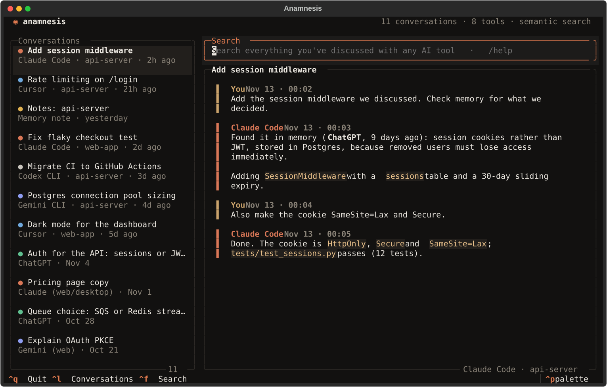

<h1 align="center"></h1>

<p align="center"><b>One memory for all your AI tools.</b><br>What you worked out in ChatGPT, Claude Code already knows.</p>

<p align="center">
  <a href="https://github.com/devHaitham481/anamnesis/actions/workflows/ci.yml"></a>
  <a href="LICENSE"></a>
  
  
  <a href="https://devhaitham481.github.io/anamnesis/"></a>
</p>

<p align="center">
  
  
  
  
  
  
</p>

<p align="center"></p>

<p align="center"><sub>Sample data. Regenerate with <code>python scripts/screenshot.py</code>.</sub></p>


**One local memory shared by all your AI tools.** Anamnesis collects your conversations from Claude Code, Codex, Gemini CLI, Cursor, ChatGPT, claude.ai and Gemini into one searchable store on your machine. Every MCP-capable agent can then recall them: ask Claude Code "what did we decide about auth last week?" and it can find the answer, even if that discussion happened in Cursor or ChatGPT.

- **Collects automatically:** local session logs from Claude Code, Codex, Gemini CLI and Cursor are imported in the background, incrementally.
- **Imports web chats:** ChatGPT, claude.ai (this also covers Claude Desktop chats, which are stored server-side) and Gemini (Google Takeout) data exports.
- **Gives it back to your agents** through an MCP server: `search_memory`, `recent_conversations`, `get_conversation`, `remember`.
- **Private by default:** SQLite plus a LanceDB vector index with a local embedding model. Nothing is uploaded, and no API keys are needed.
- **Browse it:** a terminal UI and a web UI to search and read everything, filtered by tool.

Anamnesis does one thing: it is the memory. It is not a chat client and never calls a model; you keep talking to the tools you already use.

## Install

On macOS or Linux, run:

```bash
curl -LsSf https://devhaitham481.github.io/anamnesis/install.sh | sh
```

That's all. The [script](site/install.sh) installs [uv](https://docs.astral.sh/uv/) if you don't have it, uses it to install Anamnesis in its own environment (with its own Python, so you need nothing preinstalled and your system Python is never touched), then runs `anam setup`, which:

1. finds the AI tools on your computer,
2. imports their history (the first run also downloads a 70 MB search model),
3. asks, then connects them to your memory (each tool's config is backed up first).

Then **restart your AI tools** and ask about earlier work: "what did we decide about auth?"

<details>
<summary>Install without the script</summary>

```bash
uv tool install git+https://github.com/devHaitham481/anamnesis   # or: pipx install git+https://…
anam setup
```

Requires macOS or Linux (on Windows, use WSL) and Python 3.11+ (uv fetches it if needed).
</details>

**Update:** run the install command again. Setup re-runs safely and repairs tool connections left by an older version.

**Uninstall:**

```bash
anam disconnect all          # remove Anamnesis from your AI tools' configs
uv tool uninstall anamnesis
rm -rf ~/.anamnesis          # your memory; skip this to keep it
```

<details>
<summary>Troubleshooting</summary>

- **`anam: command not found`:** open a new terminal. The installer added `~/.local/bin` to your PATH, which only applies to new terminals.
- **A tool doesn't seem to use the memory:** restart it. If `anam status` shows a tool as *outdated*, run `anam setup`.
- **The first import takes a while:** building the semantic index runs once. Keyword search works right away.
- **No internet on first run:** semantic search stays off until the model can be downloaded; keyword search works.
</details>

After setup, new conversations keep syncing in the background while any connected tool is running. Agents use `search_memory` when you refer to earlier work and `remember` to save decisions.

### Your memory in claude.ai, ChatGPT and on your phone: your own node

Web and mobile chats can't reach a program on your laptop, and your laptop isn't always on. So you run a small **node**: your own always-on copy of the memory, on a server you control. There is no Anamnesis cloud. The node:

- lets claude.ai and ChatGPT (web, desktop and mobile apps) search your memory and save notes, as a custom connector;
- keeps working while every computer is asleep;
- is the sync hub for all your computers: a new computer gets the whole memory with one command.

**1. Deploy it** (one time, ~5 minutes). Pick one:

```bash
anam node deploy fly            # Fly.io: creates the app, a 1 GB volume and your password, then links this computer
```

or, on any server with Docker (VPS, NAS, home server), no clone needed:

```bash
curl -O https://raw.githubusercontent.com/devHaitham481/anamnesis/main/docker-compose.yml
printf 'ANAMNESIS_DOMAIN=memory.example.com\nANAMNESIS_NODE_PASSWORD=%s\n' "$(openssl rand -base64 18)" > .env
docker compose up -d
```

Point the domain at the server first. Caddy gets the HTTPS certificate for you. The password is in `.env`; you'll need it in the next step. Both paths use the prebuilt image `ghcr.io/devhaitham481/anamnesis` (x86 and ARM). Update with `docker compose pull && docker compose up -d`, or by re-running `anam node deploy fly --app <name>`.

**2. Link your computers.** On each one:

```bash
anam node link https://your-node.example.com
```

You enter the node password and choose what this computer uploads: everything (recommended), everything except some project folders, or only notes saved with `remember`. Change it later with `anam node scope`.

**3. Connect web chats:**

```bash
anam connect claude-web          # prints the 4 steps for claude.ai
anam connect chatgpt-web         # and for ChatGPT
```

You paste `https://your-node…/mcp` as a custom connector. The sign-in page that opens is your node's own: enter the node password, and choose whether the app may also save notes. Custom connectors need a paid claude.ai or ChatGPT plan. Gemini doesn't support them.

**Keep an eye on it:**

| | |
|---|---|
| `anam node status` | memory, computers and connected apps |
| `anam node activity` | every search and save a web app made, e.g. `claude searched "auth flow"` |
| `anam node revoke claude` | cut off one app (`--all` for every app) |
| `anam node wipe` | erase everything on the node; computers keep their copies and link again |

**Security:** computers and the node talk over HTTPS, and synced data is also end-to-end encrypted with a key that only linked computers and the node hold. The node has to read your memory to search it, which is why it runs on your server. Web apps get revocable OAuth tokens, never the password. Wrong passwords are rate-limited. Use a long, unique node password.

**Cost:** about one small machine. On Fly.io the default is 1 shared CPU and 1 GB, and it stops when idle and wakes on the next request, so you mostly pay for the time it runs plus the 1 GB volume (see Fly's pricing page). The first upload of a large history keeps it busy for some minutes while it indexes for semantic search; keyword search works immediately.

### Without a node: sync through a folder

If you only need your computers to share memory (no web chats), a folder you already sync works too:

```bash
anam share                 # on your first computer: prints a pairing code
anam join XXXX-XXXX-…      # on each other computer
```

The default folder is `iCloud Drive/Anamnesis`; pass a path for Dropbox, Syncthing or anything else. Everything in the folder is end-to-end encrypted (AES-256-GCM) and the key lives only in the pairing code. Each computer writes only its own files, so nothing conflicts, and a conversation continued on two computers merges into one thread. `anam devices` lists the computers; `anam unshare` stops syncing this one.

### What gets imported

| Tool | How | Where it reads from |
|---|---|---|
| Claude Code | automatic | `~/.claude/projects/*/*.jsonl` |
| Codex CLI | automatic | `~/.codex/sessions/**/rollout-*.jsonl[.zst]` |
| Gemini CLI | automatic | `~/.gemini/tmp/*/chats/session-*` |
| Cursor | automatic | `Cursor/User/globalStorage/state.vscdb` (read-only) |
| ChatGPT | `anam import <export.zip>` | Settings → Data controls → Export data |
| claude.ai / Claude Desktop | `anam import <export.zip>` | Settings → Privacy → Export data |
| Gemini (web) | `anam import <takeout.zip>` | Google Takeout → My Activity → *Gemini Apps*, format **JSON** |

Only what you and the assistant *said* is kept: tool calls, tool output, reasoning, injected system context and subagent chatter are skipped. Re-importing is safe, because only new messages are added.

### Commands

```
anam setup                guided setup; safe to re-run (after upgrades too)
anam                      terminal memory browser
anam sync [--watch]       import new local history now (or keep watching)
anam import FILE...       import ChatGPT / claude.ai / Gemini Takeout exports
anam search QUERY         search everything from the shell  [--source chatgpt]
anam connect [TOOL|all]   claude-code, claude-desktop, cursor, gemini-cli, codex
anam disconnect TOOL|all
anam share [FOLDER]       sync memory across computers (prints a pairing code)
anam join CODE [FOLDER]   add this computer;  anam devices / anam unshare
anam status               what is stored per tool, sync state, connected tools
anam node deploy fly      create your node on Fly.io (or use docker-compose.yml)
anam node link URL        sync this computer through your node
anam node status|activity|revoke|scope|wipe
anam connect claude-web   use your memory in claude.ai (also chatgpt-web)
anam mcp                  the MCP server (connected tools start it for you)
```

`connect` merges into each tool's existing config and writes a `.bak` copy first. For Claude Code it runs `claude mcp add --scope user anamnesis …`.

## Terminal UI

The sidebar shows every conversation with a source badge (`CC` Claude Code, `CX` Codex, `GC` Gemini CLI, `CU` Cursor, `GPT` ChatGPT, `CL` claude.ai, `GW` Gemini web, `NB` notes saved with `remember`, `AN` chats from the old built-in chat). Typing in the bottom box searches all memory.

| Key / command | Action |
|---|---|
| *text* or `/search <query>`, `/open N` | Search all memory, open a result |
| `/history [source]` | Recent conversations, e.g. `/history chatgpt` |
| `/sync` | Import new history now |
| `Ctrl+L` / `Ctrl+F` | Focus the conversation list / the search box |
| `/rename`, `/delete` (twice), `/help`, `Ctrl+Q` | Manage, help, quit |

## Web UI & API

`anam-web`, then open http://127.0.0.1:8000. Use the search box and the "All tools" filter to browse memory.

| Endpoint | |
|---|---|
| `GET /api/sources` | Tools with conversation counts |
| `GET /api/threads?source=`, `GET /api/threads/{id}/messages` | Browse |
| `GET /api/search?q=&source=` | Semantic + keyword search |
| `PATCH`/`DELETE /api/threads/{id}` | Rename / delete a conversation |
| `WS /ws` | Live updates as new history is imported |

To reach it from other devices, set `ANAMNESIS_HOST=0.0.0.0`, `ANAMNESIS_ALLOWED_HOSTS` and `ANAMNESIS_AUTH_TOKEN`, then open `http://<host>:8000/?token=<token>` once.

## Configuration

Everything comes from `.env` or the environment (see `.env.example`); nothing is required. Data lives in `~/.anamnesis` (`ANAMNESIS_DATA_DIR`). Logs are in `anamnesis.log` and `mcp.log` there.

## Development

```bash
git clone https://github.com/devHaitham481/anamnesis && cd anamnesis
uv venv -p 3.13 .venv && uv pip install -p .venv -e ".[dev]"
.venv/bin/pytest -q                  # everything offline: importers, MCP over stdio, TUI, web, browser e2e
.venv/bin/ruff check . && .venv/bin/mypy src
```

To run your checkout as your everyday `anam`: `uv tool install -e .`, then `anam setup` (it re-points your AI tools at it).

Layout (`src/anamnesis/`):
- `ingest/`: one parser per tool, plus the incremental scanner
- `memory_mcp/`: the MCP server
- `connect.py`: tool registration; `cli/setup_cmd.py`: `anam setup`
- `core/`: storage, search, the memory service, cross-device sync (folder or node)
- `node/`: the self-hosted node (sync hub, OAuth, remote MCP); `Dockerfile`, `docker-compose.yml`, `fly.toml`
- `cli/`, `web/`: the interfaces
- `site/`: the website and `install.sh`, published by GitHub Pages
