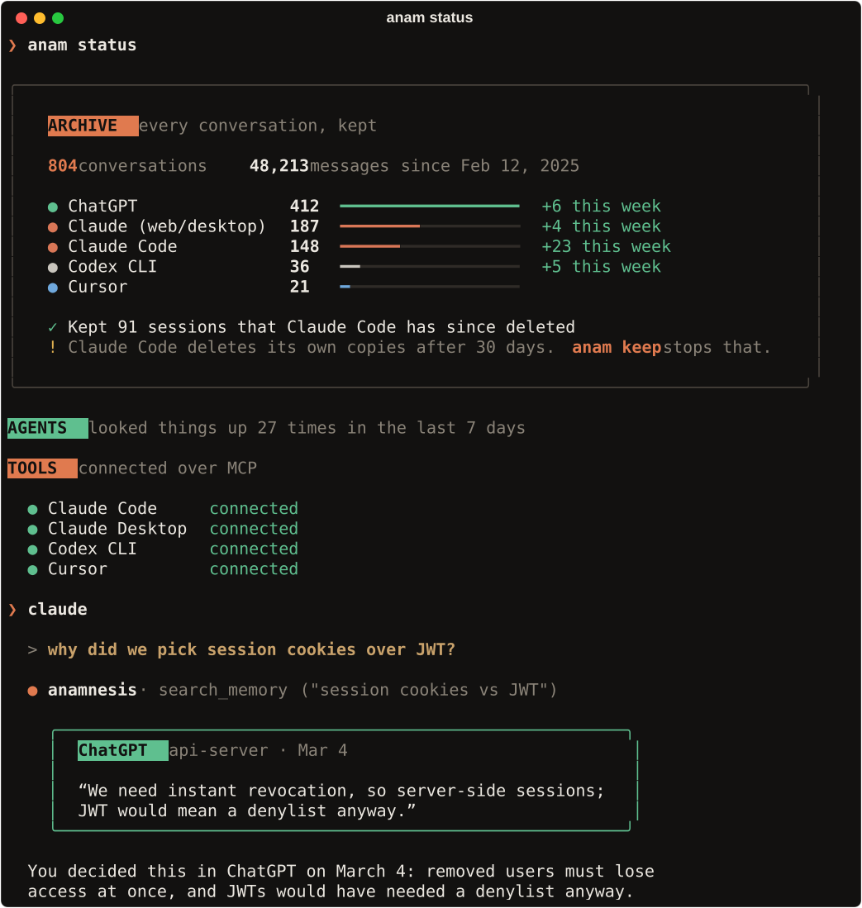

<h1 align="center"></h1>

<p align="center"><b>Never lose an AI conversation again.</b><br>Every conversation with every AI tool, kept on your computer and searchable by all of them.</p>

<p align="center">
  <a href="https://pypi.org/project/anamnesis-cli/"></a>
  <a href="https://github.com/devHaitham481/anamnesis/actions/workflows/ci.yml"></a>
  <a href="https://github.com/devHaitham481/anamnesis/blob/main/LICENSE"></a>
  <a href="https://devhaitham481.github.io/anamnesis/"></a>
</p>

<p align="center">
  
  
  
  
  
  
  
</p>

<p align="center"></p>

AI tools forget. Claude Code deletes sessions after 30 days, and none of your tools knows what you worked out in the others. Anamnesis keeps a permanent, word-for-word archive of all of them on your computer and gives it back to every tool over [MCP](https://modelcontextprotocol.io). Ask Claude Code *"what did we decide about auth?"* and it finds the answer, even if you worked it out in ChatGPT months ago.

- **Keeps** every conversation, even after the tool itself deleted it.
- **Collects** in the background, from the history your tools already write.
- **Searches** by keyword and meaning, locally, in about a tenth of a second.
- **Stays yours:** local SQLite and a small local model. No account, no API keys, no telemetry. It never calls an AI model itself.

> *Anamnesis* (Greek ἀνάμνησις) means "recollection": in Plato, learning as remembering what you already knew; in medicine, a patient's history, taken so nobody starts from scratch.

## Install

```bash
curl -LsSf https://devhaitham481.github.io/anamnesis/install.sh | sh
```

macOS or Linux (Windows: WSL). Nothing to preinstall: the [script](https://devhaitham481.github.io/anamnesis/install.sh) brings its own Python via [uv](https://docs.astral.sh/uv/), then runs `anam setup`, which finds your AI tools, archives their history, and asks before it connects them or changes anything. **Then restart your AI tools.** That's it.

<details>
<summary>Other ways, updating, uninstalling, troubleshooting</summary>

**Without the script:** `uv tool install anamnesis-cli` (or `pipx install anamnesis-cli`), then `anam setup`.

**Update:** run the install command again; setup is safe to re-run.

**Uninstall:**

```bash
anam disconnect all          # remove Anamnesis from your AI tools' configs
uv tool uninstall anamnesis-cli
rm -rf ~/.anamnesis          # your memory; skip this to keep it
```

**Troubleshooting**

- `anam: command not found`: open a new terminal.
- A tool doesn't use the memory: restart it. If `anam status` shows it as *outdated*, run `anam setup`.
- Semantic search is off: the 70 MB model downloads on first run and needs internet once. Keyword search always works.
</details>

## Using it

Just keep working. Connected tools archive new conversations in the background and search the memory when earlier work comes up.

```bash
anam status                  # what's archived per tool, and what's missing
anam auth decision           # search from the shell
anam                         # browse everything in the terminal (vim keys, / to filter)
anam import chatgpt.zip      # add a ChatGPT, claude.ai or Gemini export
anam keep                    # stop Claude Code deleting sessions after 30 days
```

| Tool | How |
|---|---|
| Claude Code, Codex, Gemini CLI, Cursor | automatic (their session files, read-only) |
| ChatGPT | export: Settings → Data controls → Export data, then `anam import` |
| claude.ai / Claude Desktop | export: Settings → Privacy → Export data, then `anam import` |
| Gemini (web) | Google Takeout → My Activity → *Gemini Apps*, format **JSON**, then `anam import` |

Only what you and the assistant said is kept; tool output, reasoning and injected system context are skipped. Re-importing is safe.

<p align="center"></p>

## In claude.ai, ChatGPT and on your phone

Web apps can't reach your laptop, so you run a **node**: your own always-on copy of the memory, on a server you control. There is no Anamnesis cloud. It also keeps your computers in sync.

```bash
anam node deploy fly             # 1. deploy once and link this computer (or Docker, below)
anam node link https://your-node # 2. on each other computer; you choose what it uploads
anam connect claude-web          # 3. prints the steps (also: chatgpt-web)
```

In the app you add `https://your-node/mcp` as a custom connector and sign in with the node password (needs a paid claude.ai or ChatGPT plan; Gemini doesn't support connectors). `anam node status` and `anam node activity` show who used it; `anam node revoke` cuts an app off.

<details>
<summary>Docker, security, cost</summary>

**Any server with Docker** (VPS, NAS, home server); point a domain at it first:

```bash
curl -O https://raw.githubusercontent.com/devHaitham481/anamnesis/main/docker-compose.yml
printf 'ANAMNESIS_DOMAIN=memory.example.com\nANAMNESIS_NODE_PASSWORD=%s\n' "$(openssl rand -base64 18)" > .env
docker compose up -d         # HTTPS via Caddy
```

- **Security:** HTTPS plus end-to-end encryption (AES-256-GCM) of synced data, with a key only your computers and your node hold. Apps get revocable OAuth tokens, never the password. Wrong passwords are rate-limited.
- **Cost:** one small machine. On Fly.io: 1 shared CPU, 1 GB memory and volume, stopped when idle.
- **Updates:** `docker compose pull && docker compose up -d`, or re-run `anam node deploy fly --app <name>`.
</details>

<details>
<summary>Only need your computers in sync? Use a folder</summary>

`anam share` on the first computer prints a pairing code; `anam join <code>` on the others. The default folder is `iCloud Drive/Anamnesis`; pass a path for Dropbox, Syncthing or anything else. Everything in it is end-to-end encrypted.
</details>

## Reference

<details>
<summary>All commands</summary>

```
anam setup                guided setup; safe to re-run
anam                      terminal memory browser
anam QUERY | search QUERY search from the shell  [--source chatgpt]
anam status               archive per tool, what's missing, connected tools
anam sync [--watch]       import new local history now (or keep watching)
anam import FILE...       import ChatGPT / claude.ai / Gemini Takeout exports
anam keep                 stop Claude Code deleting its sessions after 30 days
anam connect [TOOL|all]   claude-code, claude-desktop, cursor, gemini-cli, codex
anam disconnect TOOL|all
anam share | join | devices | unshare      sync computers through a folder
anam node deploy fly | link URL | status | activity | revoke | scope | wipe
anam connect claude-web   use your memory in claude.ai (also chatgpt-web)
anam mcp                  the MCP server (connected tools start it for you)
```

`connect` merges into each tool's config and writes a `.bak` first. MCP tools: `search_memory`, `recent_conversations`, `get_conversation`, `remember`.
</details>

<details>
<summary>Terminal UI keys</summary>

| Key | Action |
|---|---|
| `j` `k` · `g` `G` · `Ctrl+D` `Ctrl+U` | Move and scroll |
| `l` / `h` | Open a conversation / back to the list |
| `/` | Fuzzy-filter the list as you type; Enter searches every message |
| `Esc` | Clear the box, then back to the list |
| `/history [source]`, `/sync`, `/rename`, `/delete`, `/help` | Commands in the box |
| `Ctrl+Q` | Quit |
</details>

<details>
<summary>Web UI, API and configuration</summary>

`anam-web`, then open http://127.0.0.1:8000. Endpoints: `GET /api/sources`, `/api/threads`, `/api/threads/{id}/messages`, `/api/search?q=&source=`, `PATCH`/`DELETE /api/threads/{id}`, and `WS /ws` for live updates. To reach it from other devices, set `ANAMNESIS_HOST=0.0.0.0`, `ANAMNESIS_ALLOWED_HOSTS` and `ANAMNESIS_AUTH_TOKEN`.

Nothing needs configuring. Settings come from the environment or `.env` (see [`.env.example`](https://github.com/devHaitham481/anamnesis/blob/main/.env.example)). Data and logs live in `~/.anamnesis`.
</details>

## Contributing

Issues and PRs are welcome, especially importers for tools that aren't covered yet (Antigravity, Cursor's agent CLI).

```bash
git clone https://github.com/devHaitham481/anamnesis && cd anamnesis
uv venv -p 3.13 .venv && uv pip install -p .venv -e ".[dev]"
.venv/bin/pytest -q && .venv/bin/ruff check . && .venv/bin/mypy src
```

Code is in `src/anamnesis/`: `ingest/` (one parser per tool), `memory_mcp/`, `core/` (storage, search, sync), `node/`, `cli/` and `web/`.

## License

[MIT](https://github.com/devHaitham481/anamnesis/blob/main/LICENSE)
